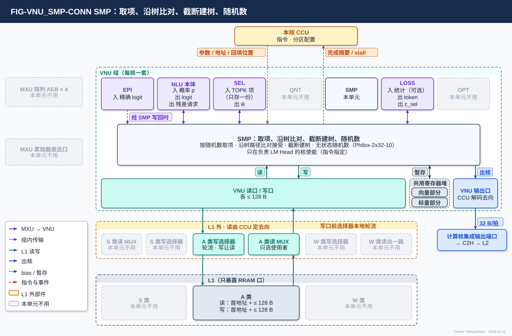
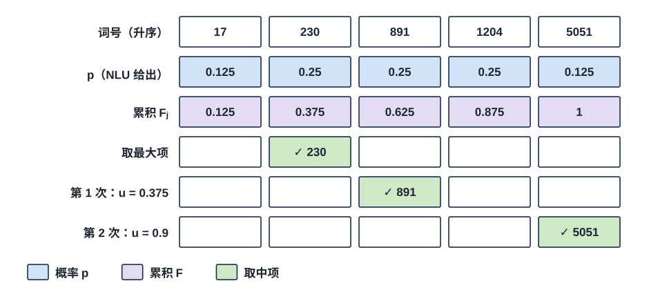
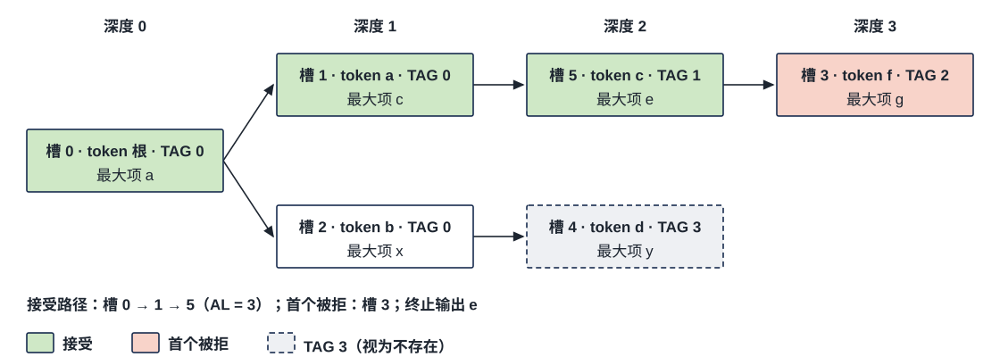
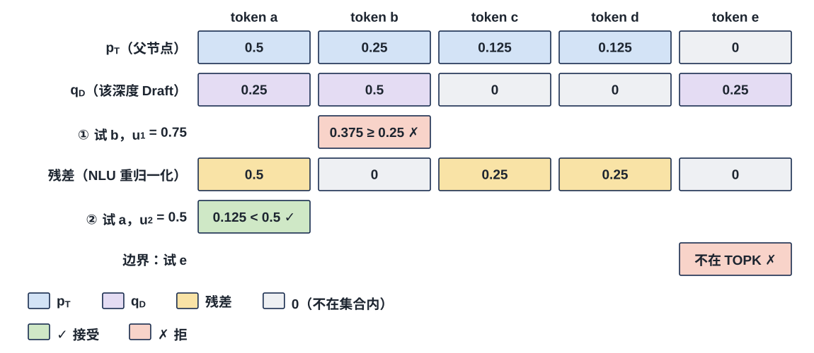
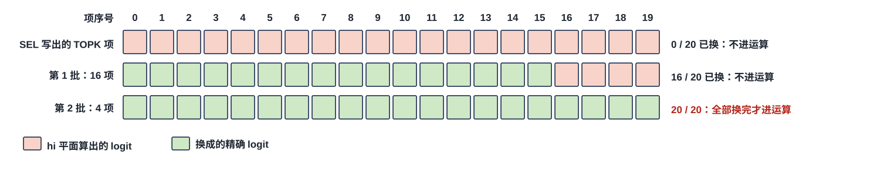
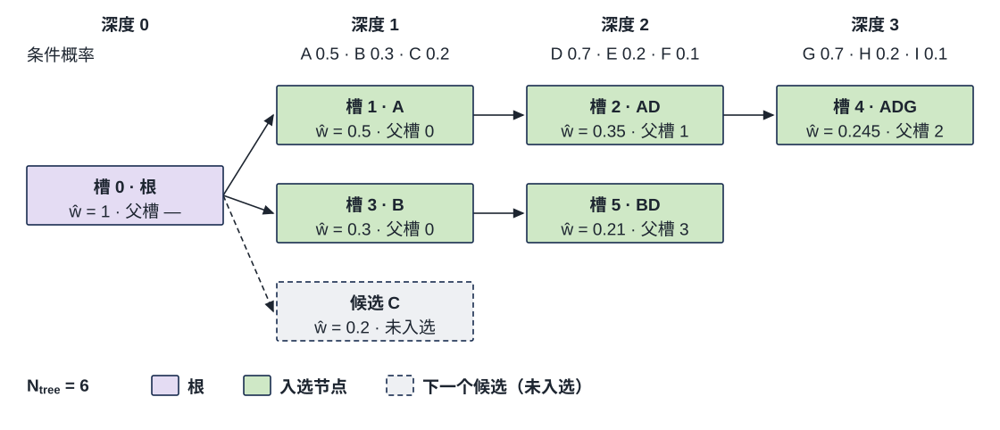

# VNU 采样单元（SMP）需求

> Owner: WangYizhao｜2026-11-11

## 1 概述

LM Head 的输出是 $Z = H\,W_{\text{head}}$：$W_{\text{head}}$ 为 $d \times V$（$d$ 为 hidden 维、$V$ 为词表大小），每个输出列 $m$ 是一个词号，每个预测位置一行 $V$ 个 logit。SEL 从每行选出值最大的 $K_{\text{top}}$ 个（词号, logit），称 **TOPK 项**；NLU 在这 $K_{\text{top}}$ 项内做归一化，得到概率 $p$。

**SMP（Sampling Unit，采样单元）在这些概率上做四件事**：按随机数取项（贪心或随机采样）；沿候选树的路径逐深度比对、决定接受到哪个节点（投机解码的树验证）；截断建树（为下一次验证选出候选树）；生成无状态随机数。

**SMP 不做的事**：

- 不做归一化：TOPK 项内的温度缩放 softmax、前缀截断后的重归一化（按个数或按累积概率，V18-SMP-08）、残差重归一化都在 NLU（V18-SMP-01）；
- 不写 TOPK 重算词号列表、不参与 TOPK 列补算：TOPK 重算词号列表由 SEL 产出，补算是 MXU 的矩阵计算、由 CCU 调度（V18-SMP-02）；
- 不给节点分档：SMP 只交出各节点的路径概率，由 SEL 的两条比较指令判出、CCU 合成档号（V18-SMP-03 / SEL-18）；
- 不算 log-prob 等统计量：归 LOSS，可选、默认关闭（V18-LOSS-05）；
- 不碰整条词表、不保存随机状态、不决定在哪些位置取项、不写 DDR、不直接通知 M55、不参与调度。

**SMP 是 VNU 组的一个单元，每核一个，四核物理相同；只在负责 LM Head 的核上使能，负责 LM Head 的核由指令指定，可以是任一核**（V18-SMP-09）；其他核的 SMP 不工作。SMP 与 VNU 组外交换数据，都经 VNU 的读口、写口与输出口（VNU 集成篇 §2）。SMP 提供本篇 §3 的四种运算形态，**某个位置用哪种、参数多少（含建树的节点数），由本核 CCU 的指令给出**；本篇不写指令字段，指令字段由 SMP 设计者按需整理、与 ISA 对接。

本篇用到的几个词（其余术语在首次出现处定义）：

| 词 | 含义 |
|---|---|
| TOPK 项 | 一个预测位置（或树节点）一行 logit 里值最大的 $K_{\text{top}}$ 项；每项就是 SEL 写出的一个名次项，**固定 8 B**（词号 3 B + logit 2 B + 3 B 补 0，VNU_SEL 篇 §3.5.2）；**每个节点只存一份，放 L1 时位置由 CCU 给，放共用寄存器堆时由 VNU_CONTROLLER 按分区算** |
| 候选树、槽号 | 候选树的节点是一个候选 token 位置，按槽号编址，根为槽 0；父槽表给出每个槽的父槽号 |
| $\hat w$ | 节点的路径概率：根到该节点各边条件概率之积 |
| $N_{\text{tree}}$、$N_{\text{pred}}$ | 一棵树的节点数（1…128）；Draft 一次预测的位置数（树深度上限） |

## 2 接口需求

### 2.1 架构图与接口汇总

图中模块框内的结构是参考实现（见第 7 章），本章以框外的各口为准。

VNU 各单元篇的连接图用同一个外框：绿色虚线框是 VNU 组，框外画出 VNU 组的全部直接对端，框内上排是 VNU 的六个单元（NLU 拆成 EPI 与 NLU 本体两格），下排是三项组级共用资源；本单元不用的对端与单元画灰（AEB 只进 EPI、MXU 累加器的粗分数直通 SEL；S 类读 MUX、S 类与 W 类写口前的写 MUX、W 类读出到 VNU 读口的一路以及 S 类与 W 类 SMP 都不用），对端之后的去向不画，在下文交代。框外下方分两层：上层是 L1 外的读写选择部件（S 类读 MUX、A 类读 MUX、W 类读出到 VNU 读口的一路由 CCU 定去向；A / W / S 三类写口前的选择器自己按固定规则在 H2C 接收桥、NWB、VNU 写口之间轮流，不由 CCU 逐拍选，V18-L1-32；归计算核集成，`CORE_INTEGRATION_STAGING.md`），下层是只暴露 RRAM 口的 L1（W / S / A 三类；图中 L1 只画三类的读写口，L1 内部组织，见 L1 篇第 7 章）；**SMP 只经 A 类读 MUX 读、经 A 类写口前的选择器写 A 类**，另在 VNU_CONTROLLER 按分区算出的位置读写 VNU 共用寄存器堆。

- **框内上排**是与 SMP 直接往来的同组单元（框内的"入 / 出"以 SMP 为准），QNT、OPT 画灰：
  - SEL：SEL 写出的 TOPK 项由 SMP 在指定的位置读（只存一份，本篇 §2.2）；SMP 把路径概率 $\hat w$ 交 SEL。
  - NLU 本体：交来归一化后的概率 $p$，收 TOPK 项 logit 与残差更新请求；
  - EPI：补算后的精确 logit 由 EPI 产出；精确值怎样写进 TOPK 项（经 SMP 写回，或由别的单元按地址写入）【设计者定】（本篇 §3.6）；图中 EPI → SMP 这一路画虚线、标"经 SMP 写回时"，表示只在选经 SMP 写回时存在；
  - LOSS：收所选 token 与所选项 logit $z_{\text{sel}}$，交回可选统计结果。
- **框内下排**：SMP 经 VNU 读口 / 写口读写 L1 的 A 类空间（A 类读出每拍整拍只给一个使用者，需求超出时 SMP 等，编译链不做带宽保证，V18-L1-21），也读写共用寄存器堆（位置由 VNU_CONTROLLER 按分区算）；输出经 VNU 输出口进框外的计算核集成输出端口，再经 C2H 写 L2，结果记录之后由 MAE 经 M1 写到共享内存，这一段不在本篇。
- **上方**：本核 CCU 给出参数、地址与每个精确 logit 对应哪一项（虚线，本篇 §3.6），SMP 回报完成摘要与 stall。

| 口 | 对端 | 方向 | 内容 | 握手 |
|---|---|---|---|---|
| TOPK 项读入 | SEL 写出的那一份（L1 A 类，地址由 CCU 给；或 VNU 共用寄存器堆，位置由 VNU_CONTROLLER 按分区算） | 入 | 每个节点 $K_{\text{top}}$ 个 8 B TOPK 项 | 随所经的口 |
| $\hat w$ 交 SEL | SEL | 出 | 每个节点的路径概率 $\hat w$ | 组内握手（VNU 集成篇 §3.6） |
| 概率口 | NLU 本体 | 入 | TOPK 项内归一化后的概率 $p$；残差分布 | 组内握手 |
| logit 与残差请求 | NLU 本体 | 出 | 一个节点的 $K_{\text{top}}$ 项 logit；残差更新请求 | 组内握手 |
| 精确 logit | EPI | 入（精确值经 SMP 写回时） | TOPK 列补算后的精确 logit，条目不带标签 | 组内握手；**经 SMP 写回时 SMP 收精确 logit 不反压 EPI、不丢** |
| 所选 token | LOSS | 出 | 所选 token 与所选项 logit $z_{\text{sel}}$ | 组内握手 |
| 可选统计 | LOSS | 入 | 所选 token 的 log-prob 等（默认关闭） | 组内握手 |
| 指令与参数 | 本核 CCU | 入 | 本篇 §3.7 的全部参数（含节点数）、读写地址、每个精确 logit 对应哪一项、监督信息使能位 | 命令侧的线（VNU 集成篇 §2.9） |
| 完成摘要与 stall | 本核 CCU | 出 | 比对完成、记录写完、建树完成；读入口来不及收时的 stall | 同上 |
| VNU 读口 / 写口（SMP 一侧） | L1 A 类（经 L1 外的 A 类读 MUX、写 MUX）、VNU 共用寄存器堆 | 入 / 出 | 工作数据、经 H2C 落 L1 的外部输入、输出数据块；一次 ≤ 128 B；L1 的读地址由 CCU 给、写只交数据与有效字节数（写地址由 CCU 计数推出），共用寄存器堆的位置由 VNU_CONTROLLER 按分区算 | 读侧无握手（核内 RRAM 协议），来不及收时拉 stall；写侧 wr_stall |
| VNU 输出口（SMP 一侧） | 计算核的集成输出端口 → C2H → L2 | 出 | 输出数据块 | 随 VNU 输出口（VNU 集成篇 §2.7） |

VNU 读口、写口与输出口的口宽以架构篇 PORT-03 / PORT-04 / PORT-09 与 VNU 集成篇 §2 为准。**组内传输的位宽、链路条数与互连方式由 VNU 集成设计者定**（VNU 集成篇 §3.6，架构篇 PORT-08）；下文各节只写交什么。

### 2.2 SEL 侧：TOPK 项在指定的位置读同一份，$\hat w$ 交 SEL

#### 2.2.1 TOPK 项只存一份，SEL 写、SMP 读同一处

**每个节点的 TOPK 项只存一份，SEL 写出、精确 logit 回填、SMP 读的是同一处：放 L1 A 类时位置由 CCU 给，放 VNU 共用寄存器堆时由 VNU_CONTROLLER 按分区算**（V18-SMP-09）。

- 每项就是 SEL 写出的名次项：**固定 8 B = 词号 3 B + logit 2 B（BF16）+ 3 B 补 0，按项首尾相接**（V18-SEL-19，VNU_SEL 篇 §3.5.2）；一个节点 $K_{\text{top}}$ 项，选择域结束时由 SEL 一次写出。
- **SMP 不另存一份，也不向 SEL 发释放通知**；这一份何时可被覆盖由 CCU 与编译链按地址安排（本篇 §5.2）。
- **SMP 不感知 TOPK 项放在 L1 还是 VNU 共用寄存器堆**，只在指定的位置读写（V18-SMP-09；本篇 §2.7）。

#### 2.2.2 $\hat w$ 交 SEL

建树后每个节点的路径概率 $\hat w$ 交 SEL，由 SEL 的两条比较指令（各带一对阈值）判出、CCU 合成 2 bit 档号（V18-SMP-03 / SEL-18，VNU_SEL 篇 §3.3.3）。$\hat w$ 的格式由 SMP 设计者定，与 SEL 对接。

### 2.3 NLU 本体口：概率入，logit 与残差请求出

| 方向 | 交什么 | 内容格式 |
|---|---|---|
| 入 | TOPK 项内归一化后的概率 $p$（按词号升序或概率降序，由指令定）；拒绝采样被拒后的残差分布 | 由两端设计者定 |
| 出 | 一个节点的 $K_{\text{top}}$ 项 logit（补算开启时全部换成精确值之后，补算关闭时直接取自 TOPK 项），交 NLU 归一化（本篇 §3.6） | BF16 |
| 出 | 残差更新请求：被拒的子候选、所用 $q_D$、是否剔除已试 token | — |

### 2.4 EPI 口：精确 logit 经 SMP 写回时入，不反压、不丢

TOPK 列补算后的精确 logit 由 EPI 产出，BF16，**条目不带标签**（V18-EPI-03）；每个精确 logit 对应哪个（节点, 项序号）由 CCU 给出（本篇 §3.6）。**由谁按地址把精确值写进 TOPK 项【设计者定】（V18-SMP-10）；若由 SMP 写回，精确 logit 经本口交 SMP，SMP 收精确 logit 不反压 EPI、不丢**；若由 EPI 或别的单元直接写，本口不用。

### 2.5 LOSS 口：所选 token 与所选项 logit 出，可选统计入

- **出**：一个取项位置所选的 token（词号），以及**所选项的 logit $z_{\text{sel}}$**（BF16）——SMP 本就持有该位置 $K_{\text{top}}$ 项的 logit，取项后直接交 LOSS，不经 NLU（V18-LOSS-07）；lse 与截断分布由 NLU 交 LOSS。前缀截断（本篇 §3.7）开启后 lse 取全 $K_{\text{top}}$ 项还是截断后的前缀【设计者定】：要定的是 lse 的口径，由 LOSS / SMP 设计者与算法侧定，约束是 LOSS 的监督效果按 VNU_LOSS 篇验收。
- **入**：指令启用时，所选 token 的 log-prob，可选熵与最大概率，由 SMP 组装进结果记录（默认关闭，V18-LOSS-05）。

### 2.6 CCU 口：指令、参数、地址与精确值对应项入，完成摘要与 stall 出

- **入**：本篇 §3.7 的全部参数（含建树的节点数）、各读写地址（TOPK 项、外部输入、输出数据块，以及放在 SMP 外的工作数据）、每个精确 logit 对应哪一项、监督信息使能位。
- **出**：比对完成、记录写完、建树完成三种完成摘要；读入口来不及收时的 stall（由 VNU 合成为 stall_vnu 交 CCU，VNU 集成篇 §2.4）。
- 变长输出不另报字节长度：SMP 只交数据与每拍有效字节数，CCU 自己数（本篇 §3.8）。

### 2.7 VNU 读口 / 写口：在指定的位置读写 TOPK 项与输入输出数据块

**SMP 在指定的位置读写 TOPK 项、外部输入与输出数据块：放 L1 A 类时位置由 CCU 给（读由 CCU 发，写的地址由 CCU 按 SMP 交出的有效字节数计数推出）；放 VNU 共用寄存器堆时由 VNU_CONTROLLER 按分区算。放哪一处由指令的 1 bit 选，SMP 不感知**（V18-SMP-09、V18-VNU-12，VNU_CONTROLLER 篇 §2.2、§3.6）。**其余工作数据（父槽表副本、建树状态、取项与比对的暂存）放在哪由设计者定，只要求不丢、结果逐位相同；放在 SMP 外时同样在指定的位置读写**（V18-TP-84 (3)，清单 A10；参考放处见 §7.1）。VNU 共用寄存器堆只由 CCU 给分区配置、逐拍读写位置由 VNU_CONTROLLER 算（V18-VNU-10 / 12，VNU 集成篇 §3.3）。

- **读**：工作数据、经 H2C 落 L1 的外部输入（父槽表、TAG 表、Draft 分布、随机数向量，都是"数据"类外部信息，外部信息篇）。经 L1 外的 A 类读 MUX、VNU 读口到达 SMP；L1 交回按首地址对齐好的数据（架构篇 §3.5.4）；读侧没有握手，来不及收时拉 stall（本篇 §2.6）。
- **写**：放在 SMP 外的工作数据、输出数据块（写 L1 时）、由 SMP 写回时的精确 logit（本篇 §3.6）。SMP 写 L1 时只交数据与每拍的有效字节数（≤ 128 B，从第 0 字节起），不给地址；写的首字节地址与 `seg` 由本核 CCU 内部计数推出（V18-VNU-12，VNU_CONTROLLER 篇 §3.9）；经 VNU 写口进 A 类写口前的选择器（L1 外，自己在 H2C 接收桥、NWB、VNU 写口之间按固定规则轮流，写与读碰到同一个堆时写让读，V18-L1-32，架构篇 §3.7）；VNU 写口来不及时拉 wr_stall 交 SMP，**SMP 保持待写的数据、不丢**；核内写 L1 的完成由 CCU 判定；VNU 写口的写何时写完，由写口前的选择器告知 CCU 或由 VNU 报完成【设计者定】（V18-L1-32）（架构篇 §3.9）。
- **同一个堆同一拍只做一次访问：读由 CCU 排，写碰到读时由写口前的选择器本地让读**（架构篇 §3.4 CONC-1 / 2，V18-L1-32）；SMP 一侧不需要做字节移位（移位在 SRAM 内部）。

### 2.8 VNU 输出口：输出数据块直接写 L2

**每个输出数据块写 L1，或经 VNU 输出口、计算核的集成输出端口走 C2H 写 L2，由 CCU 解码指令选**（用户 11-08："可以支持写L1或者走C2H（本质写L2）"；V18-VNU-07，VNU 集成篇 §2.7）。本核还要读回的（树记录组、TOPK 项）写 L1 或共用寄存器堆。写 L2 的记录以 CCU 数满 L2 回来的写入握手为准（协议篇 §3.13）。

## 3 功能描述

### 3.1 功能一览

| 功能 | 按向量维度说做什么 | 输入 | 输出 | 典型用途 | 节 |
|---|---|---|---|---|---|
| 按随机数取项 | 在一个位置的 $K_{\text{top}}$ 个概率上，取最大项，或按随机数沿累积概率取一项 | $p$、随机数 | 所选词号 | 贪心与随机采样；接受路径末端再取一个 token；被拒后在残差分布上重取；同一位置分叉取多次 | §3.2 |
| 沿树路径比对接受 | 从根逐深度，把子节点的 token 与父节点的分布比对 | 候选树、各节点 $p$、Draft 分布、随机数 | 接受路径、接受长度、首个被拒槽号 | 投机解码的树验证 | §3.3 |
| 截断建树 | 从各深度 TOPK 项的条件概率中选 ≤ $N_{\text{tree}}$ 个节点组成树 | 各深度 $p$ | 树记录组、各节点 $\hat w$ | 为下一次验证准备候选树 | §3.4 |
| 无状态随机数生成 | 由种子与计数器现算随机数，不存状态 | 种子、计数器输入 | $[0, 1)$ 内的随机数 | 采样与拒绝采样 | §3.5 |
| 精确 logit 替换 | 补算开启时，归一化、采样与比对用的 TOPK 项 logit 是全码重算的精确值 | 精确 logit、CCU 给的对应项 | 换成精确值的 TOPK 项 | TOPK 列补算开启时 | §3.6 |
| 参数与输入 | — | 指令、外部输入 | — | 一次运算开始前锁存 | §3.7 |
| 输出数据块 | — | 运算结果 | 接受路径列表、结果记录、条件概率记录、树记录组、监督信息 | 写 L1 或写 L2 | §3.8 |
| 监督信息 | 按所选算法给监督行与目标分布 | 比对结果、TOPK 项 | 监督信息 | 监督使能时 | §3.9 |
| 结果规则与先写后报 | — | — | 完成摘要 | 恒定 | §3.10 |
| 集成精度与输入格式 | — | — | — | 恒定 | §3.11 |
| 复位 | — | 复位 | 清 SMP 内部状态 | 复位 | §3.12 |

**SMP 同一时刻只服务一个任务；与其他单元在计算资源不冲突时可以同时工作，由 CCU 按指令编排**（V18-VNU-06）。**TOPK 项是全部运算的唯一输入集合：TOPK 项之外的词视为 $-\infty$，概率为 0**；不设全词表采样。SMP 的工作量只与节点数 × $K_{\text{top}}$ 成正比，与词表大小 $V$ 无关。

### 3.2 按随机数取项：取最大项，或沿词号升序累积到第一个超过 $u$ 的项

- **取最大项**：取 $p$ 最大的一项；并列时取词号小者。
- **按随机数取项**：给定 $u \in [0, 1)$，沿词号升序累积 $F_j = \sum_{i \le j} p(v_i)$，**取第一个满足 $F_j > u$ 的项**。
- **同一位置可取多次**：用 $n_{\text{samp}}$ 个随机数各取一次，结果按次序写出，共用一次归一化。$n_{\text{samp}}$ 是每个位置的取项次数；Batch 行数另记为 $B$。
- 在残差分布上重取用同一规则（本篇 §3.3）。

图中 5 项按词号升序排列（实际 $K_{\text{top}}$ 项，参考 20）：

- 取最大项时，三项并列 0.25，取词号最小的 230。
- $u = 0.375$ 恰等于 $F_2$，按"第一个 $F_j > u$"取第 3 项 891；$u = 0.9$ 取第 5 项 5051。
- 两次取项共用同一组 $p$。
- 例中概率都是 2 的幂之和，脚本断言了累积值与三次取项结果。

### 3.3 沿树路径逐深度比对接受

**候选树**：节点是一个候选 token 位置，按槽号编址，根为槽 0；父槽表给出每个槽的父槽号。每个节点有自己的 TOPK 项，即该位置一行 logit 的前 $K_{\text{top}}$ 项。从根开始逐深度，把子节点的 token 与父节点 TOPK 项上的分布比对。

#### 3.3.1 两种比对

- **贪心比对**：子节点的 token 等于父节点的最大项即接受；同一父节点至多接受一个子节点。
- **拒绝采样比对：以 $u_y\,q_D(y) < p_T(y)$ 判接受，不做除法；这个比较式是比较口径，须与算法参考模型逐位一致**（本篇 §3.10.2）。
  - $p_T$ 是父节点 TOPK 项上的归一化概率，$q_D$ 是该深度的 Draft 分布（上一轮该深度 TOPK 项的归一化概率），两侧用同一温度。
  - 子 token 不在父节点 TOPK 项内，直接拒。
  - 被拒后，SMP 请 NLU 把父节点分布更新为残差 $\mathrm{norm}(\max(0, p_T - q_D))$（在父节点与该深度 TOPK 项的并集上），再按给定次序试下一个子节点。
  - 全部子节点被拒时，在残差分布上取项（本篇 §3.2），作为本深度的输出，比对结束。

#### 3.3.2 规则与输出

**规则**：

- TAG 为 3 的节点视为不存在；
- **比对结果与槽号次序无关**，父槽号可以大于子槽号；
- **节点数由指令给出，≤ 128（父槽号 7 bit）**；深度 ≤ $N_{\text{pred}}$；
- 共用一个槽号空间的多棵树可同时比对，各自独立；单节点树的根恒被接受。

**输出**：接受路径的槽号（按深度）、接受长度 AL（接受的节点数，含根）、首个被拒槽号与有效位、终止方式（到叶后再取一个 token，或在残差分布上重取）。

#### 3.3.3 须支持的情形

**SMP 须支持以下情形，实现不规定**（用户 11-08："SMP可能要处理这个模式，因此SMP需要支持它，具体怎么实现不做要求"）：

| 情形 | 要支持什么 |
|---|---|
| 一个父节点有多个子候选 | 按指令给出的次序尝试（默认槽号升序） |
| 被拒后试下一个子候选 | $q_D$ 剔除已试 token 再重归一化，或不剔除，两种都支持，由指令选；重归一化由 NLU 做 |
| 多个子候选全被拒 | 结果记录里的"首个被拒槽号"按指令所选规则报出 |

图中 6 节点树，绿色为接受、红色为首个被拒：

- 根的最大项是 a，槽 1 的 token 是 a，接受；
- 槽 1 的最大项是 c，槽 5 的 token 是 c，接受；
- 槽 5 的最大项是 e，槽 3 的 token 是 f，拒。

所以接受路径为槽 0 → 1 → 5，AL = 3，首个被拒槽号为 3，终止时输出槽 5 的最大项 e。槽 3 的父槽号 5 大于自己的槽号，比对不受影响；槽 4 的 TAG 为 3，视为不存在。脚本按父槽表迭代求深度并断言了路径。

图中父节点的 TOPK 项为 {a, b, c, d}，该深度的 Draft 分布覆盖 {a, b, e}；试行一行的格子写 $u\,q_D(y)$ 与 $p_T(y)$（或残差）的比较，✓ 为接受、✗ 为拒：

- 先试 $y_1 = b$：$0.75 \times 0.5 = 0.375$ 不小于 $p_T(b) = 0.25$，拒。
- NLU 算出残差 $\max(0, p_T - q_D)$ 并重归一化：a 0.5、c 0.25、d 0.25。
- 再试 $y_2 = a$：$0.5 \times 0.25 = 0.125 < 0.5$，接受。
- 若子候选是 e，它不在父节点 TOPK 项内，直接拒。
- 本例 $q_D$ 不剔除已试 token。剔除的变体由 NLU 把 $q_D(b)$ 置 0 再归一化，两种都须支持。脚本断言了残差与两次判定。

### 3.4 截断建树：按路径概率选 ≤ $N_{\text{tree}}$ 个节点，择优算法放开

从各深度 TOPK 项的条件概率中选不超过 $N_{\text{tree}}$ 个节点，组成下一次验证的候选树。**保留 TOPK 截断，不按 $q_D$ 抽样。**

- **$N_{\text{tree}}$ 由指令给出，1…128**（V18-SMP-09，用户 11-11："指令会告诉SMP当前要建多少个节点出来"）；根为槽 0、TAG 0，深度 ≤ $N_{\text{pred}}$。
- **择优算法由设计者与算法侧确定，判据是接受长度 AL 与建树拍数，不要求与参考算法选出同一棵树**（用户 11-02）；选定算法后，硬件与同步更新的参考模型逐位一致。参考算法见本篇 §7.2。
- **SMP 交出每个节点的 $\hat w$，由 SEL 的两条比较指令判出、CCU 合成 2 bit 档号**（档 3 = 剪掉），CCU 写进节点档表（V18-SMP-03 / SEL-18）。档号怎样用于后续计算由 CCU 决定，VNU 不感知分档。
- **输出格式不放开**：每个节点一条树记录 4 B（词号 18 bit + 父槽号 7 bit + TAG 2 bit + VALID 1 bit）、父槽表（每槽 7 bit）、节点档表（节点数 8 bit + 每槽 2 bit TAG）、祖先掩码（节点 $i$ 是否为节点 $j$ 祖先的 0 / 1 矩阵，按 32 × 32 bit 块、每块 128 B）、嵌入词号列表、占槽数与有效节点数。字段布局归数据组织篇与 CIF 篇 §2.8.1。
- 候选树由 M55 给出时 SMP 不建树；两种来源输出同一格式。

### 3.5 无状态随机数生成：Philox-2x32-10，M55 能离线重放

- **核心函数为计数器型 Philox-2x32-10**：输出 = 固定函数（32 bit key, 2 × 32 bit 计数器），10 轮。**按 Random123 的官方定义，不允许换轮数或变体**（用户 11-02）。核心函数零输入的已知答案为 (0xFF1DAE59, 0x6CD10DF2)。
- **不保存、不推进任何状态**：随机数由种子与计数器输入现算，计数器输入由控制方给出。
- **随机数按用途编号，每个只用一次**：每个非根节点一个、每个终止位置一个、每个取项位置每次一个。**Batch 多序列下各序列的编号互不重复，且可按同一规则重放**（V18-SMP-06）。
- 指令给出随机数向量时，以向量为准。
- **位级绑定由设计者定，登记为与 M55 共用的唯一定义**（V18-SMP-04；登记处 CIF 篇 §2.8.1），M55 按登记重放。要定的有：种子与（调用号, 轮号, 编号, Batch 行号）怎样装进 key 与计数器、取哪个输出字、怎样变成 $[0, 1)$、随机数向量每项的格式。参考绑定见本篇 §7.3。

### 3.6 精确 logit 替换：补算开启时运算用精确值，一个节点全部换完才进入运算

**TOPK 列补算是 MXU 的矩阵计算，由 CCU 调度，与 SMP 无关**（用户 11-08："补算是矩阵计算，本来就不应该和SMP有关系"）：MAE 按 SEL 的 TOPK 重算词号列表取 $W_{\text{head}}$ 的按列全码副本落 L1 W 类、尺度落 S 类，阵列按 8 bit 权重模式一遍算出精确 logit（V18-MXU-09、V18-DORG-05 (2)；登记篇 REG-21）。本节只写精确 logit 怎样进入 SMP 的运算。

#### 3.6.1 补算开启时：运算用全码重算的精确值

**补算开启时，归一化、采样与比对所用的 TOPK 项 logit 须是全码重算出的精确值；一个节点的全部 TOPK 项都换成精确值之后，该节点才进入归一化与采样**（V18-SMP-10）：

- 精确 logit 由 EPI 产出，**条目不带标签；每个精确值对应哪个节点的哪一项，由 CCU 给出**（V18-EPI-03）。
- **换的是 SEL 写出的那一份 TOPK 项（只存一份，本篇 §2.2.1）里该项的 logit 字段；词号与成员不变**（V18-SMP-09 / 10）。
- **由 EPI、SMP 还是别的单元按地址把精确值写进 TOPK 项【设计者定】**（V18-SMP-10）：要定的是这次写由谁执行、"一个节点全部换完"由谁判定；约束是上两条、写到 TOPK 项所在的位置（放 L1 时由 CCU 给，放共用寄存器堆时由 VNU_CONTROLLER 按分区算）、不丢。参考做法见本篇 §7.7。
- 全部换完后交 NLU 重做该节点的归一化。

图中一个节点 20 项：SEL 写出的 TOPK 项一开始全是 hi 平面算出的 logit；第一批 16 个精确 logit 换入后仍有 4 项未换，不进运算；第二批 4 个换完后才交 NLU 归一化（右侧计数为已换项数）。图中不画由谁写入。分几批到达由 MXU 与 CCU 的排法决定；每个精确值对应哪一项由 CCU 给，由谁写入由设计者定（§3.6.1）。

#### 3.6.2 补算关闭时：直接用 SEL 写出的 logit

补算关闭时，TOPK 项以 SEL 写出时的 logit 直接交 NLU 归一化，不等精确值。

### 3.7 参数与输入的来源

以下都由指令给出，本篇不写字段。

| 参数 | 说明 |
|---|---|
| 取项方式 | 取最大项，或按随机数取项 |
| $K_{\text{top}}$ | 与 SEL 同一取值，由指令配置，不设由缓冲定容的上限 |
| 取项位置与 $n_{\text{samp}}$ | SMP 不判断哪个位置需要 token |
| 节点数 | 建树要建多少个节点（$N_{\text{tree}}$，1…128）、比对的树有多少个节点，由指令给出（V18-SMP-09） |
| 负责 LM Head 的核 | 由指令指定，可以是任一核（V18-SMP-09） |
| 前缀截断方式 | **按个数（前 $n$ 项）或按累积概率（首次 $\ge p_{\text{cut}}$ 的最短前缀），两种都支持、由指令选**（V18-SMP-08）；截断与截断后的重归一化在 NLU（VNU_NLU 篇 §3.4），SMP 在截断后的分布上取项 |
| 多候选的尝试次序 | 默认槽号升序 |
| $q_D$ 是否剔除已试 token | 两种都支持 |
| 首个被拒槽号的报法 | 多候选全拒时按所选规则 |
| 建树参数 | $N_{\text{tree}}$ 与所选算法的参数 |
| 随机数来源 | 种子 8 B + 计数器输入，或随机数向量；同时给出时以向量为准；个数为 0 且无种子时只能取最大项 |
| 候选树、TAG 表、Draft 分布的来源 | 片上留存（本核上次建树与归一化的结果）或 M55 给出；**用哪一份由驻留选择位逐项选择，M55 给出的优先**（用户 11-02："冗余设计、必须保留"）；留存内容的版本核对归 LIC |
| 监督信息使能 | CCU 把调用级与位点级两个开关合成一位交 SMP |
| 工作数据的地址 | TOPK 项、工作数据、外部输入、输出数据块的地址都由 CCU 给（本篇 §2.7） |

- **参数在一次运算开始前锁存**，运算中不变；何时换参数由 CCU / LIC 定。
- 温度 $T_{\text{temp}}$ 随归一化归 NLU；Draft 分布与 Target 分布用同一温度。
- 外部输入（父槽表、TAG 表、Draft 分布、随机数向量）都是"数据"类外部信息（外部信息篇），经 H2C 落 L1，SMP 经 VNU 读口读入。

### 3.8 输出数据块与去向

| 数据块 | 内容 | 打包 |
|---|---|---|
| 接受路径列表 | 按深度的槽号，每项 3 B | 变长，每份末尾补齐到存储字 |
| 结果记录 | 接受路径、AL、首个被拒槽号与有效位、终止方式、输出 token（18 bit）、监督行集合连同每行的深度与首拒标志、执行状态；**log-prob 等为可选字段，默认不含** | 格式登记在 CIF 篇 §2.8.1 |
| 条件概率记录 | 每个位置 $K_{\text{top}}$ 项，每项词号 3 B + 概率 2 B，位置内按概率降序 | 变长，每条末尾补齐到存储字 |
| 树记录组 | 本篇 §3.4 的全部输出 | 数据组织篇、CIF 篇 §2.8.1 |
| 监督信息 | 本篇 §3.9 | CIF 篇 §2.8.1 |

- 变长数据块里每条（一个位置的条件概率记录、一份接受路径列表）默认从存储字边界起、内部紧凑，下一条从下一个存储字边界起，末字只写有效字节，**以条为单位只在末尾补齐**（V18-DORG-03、V18-TP-74，数据组织篇 §2.3 / §3.4）；SRAM 支持紧密存储（架构篇 §3.5.4），SMP 的输出按默认对齐使用。**SMP 只交数据与每拍有效字节数，CCU 自己数出每条的长度、累加地址**（V18-VNU-12）；**CCU 怎样知道一条在哪一拍结束、以便下一条从字边界起【待确认】**（建议：一次写不跨两条，每条的最后一次写带一位"本条结束"；或由指令给出每条的项数）。
- **条件概率的 2 B 编码由设计者定，登记为与 M55 共用的唯一定义**（V18-SMP-04；登记处 CIF 篇 §2.8.1）：M55 建树时直接相乘得路径概率，拒绝采样时又作为 $q_D$ 读回，所以这 2 B 是与 M55 共用的格式。参考 BF16，精度按本篇 §3.11 的集成后要求验收。
- 字节布局归数据组织篇与 CIF 篇 §2.8.1。
- **去向**：写 L1，或经 VNU 输出口走 C2H 写 L2，由 CCU 解码指令选（本篇 §2.8）。

### 3.9 监督信息：来源与监督行选择放开

监督使能时，按所选算法从比对结果与 TOPK 项给出监督行及其目标分布。**来源与监督行的选择放开**（用户 11-02），须满足：

- 不遍历全词表；
- 监督效果按 VNU_LOSS 篇验收。

**监督信息不规定每行字节上限**（V18-SMP-09，用户 11-11："我认为这里没必要规定上限"）：超过 32 B 的数据由 CCU 拆成多个 32 B 交给 SMP 或写出，SMP 内部存多少由设计者定。监督行的槽号、深度、首拒标志写进结果记录。

### 3.10 结果规则与先写后报

#### 3.10.1 先写后报

**完成摘要晚于对应的全部记录写完**：写 L1 的记录由 CCU 计数推出地址、经写口前的选择器写入，何时写完由选择器告知 CCU 或由 VNU 报完成【设计者定】（V18-L1-32）；写 L2 的记录以 CCU 数满 L2 回来的写入握手为准（协议篇 §3.13）。记录出核后的完成、向 M55 报完成，归 LIC / MAE。

#### 3.10.2 结果只依赖输入；比较类结果与参考模型逐位一致

- 同一组 TOPK 项、Draft 分布与随机数（或同一种子与计数器输入）下，结果逐位相同。
- **取最大项、贪心比对、拒绝采样判定（比较式 $u_y\,q_D(y) < p_T(y)$）与算法参考模型逐位一致**；硬件实现太难时交回算法侧改口径并同步参考模型，硬件不自行更换（用户 11-02）。

### 3.11 集成精度与输入格式

**SMP 的计算方案集成到算法后，任务精度下降 < 0.1%**；中间精度不规定，由设计者定（用户 11-04，V18-VNU-01）。口径：

- 下降量按绝对百分点计；
- 基线为同一算法下各运算按 FP32 理想值计算；
- 评测集为算法侧的标准评测集。

验收中另以同一口径报告 AL 相对 FP32 理想值基线的变化，作为观测量，不另设门限。

**输入格式**：概率来自 NLU，格式由两端设计者定；logit 为 BF16；词号、槽号、父槽表、TAG 为索引数据；条件概率 2 B 与随机数向量是与 M55 共用的格式，由设计者定、登记在 CIF 篇 §2.8.1。

### 3.12 复位

**复位输入来自 CIF（架构篇 PORT-41），硬复位与软复位不区分（CIF 篇 §2.4、§3.3）。** **复位清 SMP 内部的工作状态（在途的取项、比对与建树状态、残差工作暂存），不保存随机状态**；写在指定位置的数据（TOPK 项、树记录组等）不由 SMP 清。片上留存的树记录组能否再用，由 LIC 按驻留版本判定。

## 4 性能指标

### 4.1 各口的速率要求

**SMP 的处理能力与处理时间须匹配上下游，由 SMP 设计者与相关模块（SEL、NLU、EPI、LOSS、VNU 读口 / 写口）对接确定**；参考值见本篇 §7.4。SMP 单方面承诺的只有一条：

| 口 | 要求 | 超额时 |
|---|---|---|
| EPI 口（精确 logit，经 SMP 写回时） | **SMP 收精确 logit 不反压 EPI、不丢** | 不允许超额 |
| 其他组内口 | 不丢 | 经组内握手停发，只降速 |
| VNU 读口 / 写口 | 不丢 | 读侧经 stall_vnu 让 CCU 停发、写侧 wr_stall 让 SMP 保持，只降速 |

尾段时延由 SEL、NLU、MXU、MAE 共同决定，不由 SMP 单方面承诺（用户 11-08 认可"拍数只作参考"）。

### 4.2 同时使用的口与并发条件

| 同时使用的情形 | 适用的约定 | 结果 |
|---|---|---|
| SMP 经 VNU 读口读、经 VNU 写口写 L1 A 类 | 架构篇 §3.4 CONC-1 / CONC-2 | 读与写落不同的堆时同拍进行；同一个堆同一拍只做一次访问：读由 CCU 排，写碰到读时写让读（写口前的选择器本地判断，V18-L1-32） |
| SMP 与 VNU 其他单元分用 VNU 读口 / 写口 | 架构篇 §3.7（A 类读 MUX 每拍只送一个使用者） | 读口每拍读什么由 CCU 排；读出在 VNU 内分给谁、各单元轮用写口的先后由 VNU_CONTROLLER 按配置定（VNU_CONTROLLER 篇 §3.4）；编译链不做读写带宽保证，需求超出时 SMP 等（V18-L1-21） |
| SMP 与 VNU 其他单元的计算 | VNU 集成篇 §3.2.1 | 计算资源不冲突时可同时工作 |

### 4.3 要求值表

| 项 | 要求 | 说明 |
|---|---|---|
| 运算形态 | 本篇 §3 的四种（取项、比对、建树、随机数）；补算开启时用精确 logit | 不含归一化、补算、分档 |
| 节点数 | 由指令给出，≤ 128（父槽号 7 bit） | 本篇 §3.3.2、§3.4 |
| 负责 LM Head 的核 | 由指令指定，任一核 | 本篇 §1 |
| TOPK 项 | 每节点只存一份，放 L1 时位置由 CCU 给，放共用寄存器堆时由 VNU_CONTROLLER 按分区算；每项 8 B | 本篇 §2.2.1 |
| 随机数 | Philox-2x32-10，无状态，按用途编号、每个只用一次 | 本篇 §3.5；速率参考见本篇 §7.4 |
| 拒绝采样比较式 | $u_y\,q_D(y) < p_T(y)$，与参考模型逐位一致 | 本篇 §3.3.1 |
| 精确 logit | 补算开启时运算用精确值；一个节点全部换完才进入归一化与采样；经 SMP 写回时不反压 EPI、不丢 | 本篇 §3.6 |
| 精度 | 集成后任务精度下降 < 0.1% | 中间精度【设计者定】：要定的是各运算的中间格式，约束是集成精度 |
| 监督信息 | 不遍历全词表；不规定每行字节上限 | 本篇 §3.9 |

## 5 约束与由使用者保证的事项

### 5.1 硬约束

- **TOPK 项是唯一运算空间**：不设全词表采样（本篇 §3.1）。
- **不保存随机状态**（本篇 §3.5）。
- **本篇不含容错设计**（V18-TP-75）。

### 5.2 由使用者保证的事项

以下事项 SMP 不检查，由对应方保证；验收时作为输入前提，用断言核对（本篇 §6.1）。

| 事项 | 由谁保证 |
|---|---|
| TOPK 项怎样选出与并列规则；TOPK 重算词号列表；节点 $\hat w$ 的分档判断 | SEL |
| **每个节点的 TOPK 项的位置（L1 A 类或 VNU 共用寄存器堆）；SEL 写、回填、SMP 读用同一个地址；这一份何时可被覆盖** | CCU 与编译链（V18-SMP-09，`CCU_STAGING.md`） |
| TOPK 项内归一化、两种前缀截断后的重归一化（按个数、按累积概率）、残差重归一化（含剔除已试 token 的变体） | NLU |
| TOPK 列补算的全部：MAE 按 SEL 的 TOPK 重算词号列表取 $W_{\text{head}}$ 的按列全码副本落 L1 W 类、尺度落 S 类，阵列按 8 bit 权重模式一遍算完 | MAE、MXU、CCU（V18-MXU-09、V18-DORG-05 (2)；登记篇 REG-21） |
| 每个精确 logit 对应哪个（节点, 项序号） | CCU（条目不带标签，V18-EPI-03） |
| 档号写进节点档表、在位点边界翻转与跨核同步；按档选门限 | CCU（V18-SEL-16） |
| 节点数、负责 LM Head 的核 | 指令（V18-SMP-09） |
| 外部输入在使用前装入 L1 并就绪；随机数向量个数够用；片上留存内容的驻留版本核对 | LIC、MAE |
| 哪些位置取项、每个位置取几次 | 指令 |
| 工作数据放 L1 时的地址、放共用寄存器堆时的分区配置，与段长够用；A 类读 MUX 每拍给哪个使用者（在 L1 外）；读的排拍（写与读碰到同一个堆时由写口前的选择器本地写让读，V18-L1-32）；外部输入落进 L1 是否写完以 MAE 发给本核 CCU 的写完通知为准（V18-TP-70） | CCU（协议篇 §3.8，架构篇 §3.4 CONC-1 / 2、§3.7） |
| 超过 32 B 的数据（如监督信息）拆成多个 32 B | CCU（V18-SMP-09） |
| 变长输出每条的长度（CCU 按有效字节数自己数）、地址累加与项数（给 MAE 用的列表，项数由生产核 CCU 写成定长计数项，V18-DORG-05 (5)） | CCU（数据组织篇 §2.6） |
| 记录与列表的字节布局；条件概率 2 B 编码与随机数位级绑定的登记 | 数据组织篇、CIF 篇 §2.8.1 |
| 建树与监督算法的参考模型 | 算法侧 |

## 6 验收

### 6.1 本模块验收项

| 验收项 | 方法 | 判据 | 出处 |
|---|---|---|---|
| 取项 | 逐位比对 | 并列取词号小者；$u = F_j$ 的边界；同一位置多次取项共用一次归一化；在按个数、按累积概率两种前缀截断后的分布上取项；交 LOSS 的 $z_{\text{sel}}$ 与所选词号的 TOPK 项 logit 逐位相同 | §3.2、§2.5 |
| 贪心比对 | 逐位比对 | 槽号重排后结果只随槽号重命名；TAG 3 节点不参与 | §3.3 |
| 拒绝采样比对 | 逐位比对 + 统计 | 比较式 $u_y\,q_D(y) < p_T(y)$ 逐位一致；不在父 TOPK 项内直接拒；$q_D$ 剔除 / 不剔除两种；多候选次序与首个被拒槽号报法；输出 token 分布相对截断 Target 分布的偏差实测报告 | §3.3 |
| 节点数由指令给 | 逐位比对 | 节点数 1 / 24 / 32 / 33 / 128 的比对与建树 | §3.3.2、§3.4 |
| 截断建树 | 对照参考算法 | 按 AL 与建树拍数对照；输出格式逐字段核对 | §3.4 |
| 随机数 | 逐位比对 | 与 M55 按登记的绑定离线重放逐位相同；零输入已知答案；Batch 多序列编号不重复 | §3.5 |
| TOPK 项只存一份 | 断言 | SMP 读的、精确值写的都是同一份（放 L1 时 CCU 给的地址，放寄存器堆时 VNU_CONTROLLER 按分区算的位置）；SMP 不另存一份、不发释放通知；TOPK 项放 L1 与放寄存器堆两种结果相同 | §2.2.1 |
| 精确 logit 替换 | 逐位比对 | 补算开启时归一化、采样与比对用的是精确值；精确 logit 分几批、按什么次序到达，结果都相同；只改 logit 字段、词号与成员不变；一个节点未全部换完时不进入归一化与采样；经 SMP 写回时不反压 EPI | §3.6、§4.1 |
| 先写后报 | 断言 | 完成摘要不早于全部记录写完 | §3.10.1 |
| 负责 LM Head 的核 | 审查 + 仿真 | 指令把 LM Head 指给任一核时该核 SMP 工作、其他核不工作 | §1 |
| 输入前提 | 仿真断言 | 本篇 §5.2 所列由使用者保证的事项逐项断言核对，SMP 自身不检查 | §5.2 |
| 集成精度 | 算法侧评测 | 任务精度下降 < 0.1%；同时报告 AL 变化 | §3.11 |

### 6.2 与上下游模块的对接检查

| 对接项 | 对端 | 检查内容 |
|---|---|---|
| TOPK 项 | VNU_SEL 篇 §2.7、§3.5.2 | SEL 在指定的位置写出 8 B 名次项；SMP 读同一份；SEL 不收 SMP 的释放通知 |
| 精确 logit 的对应项与写入方 | CCU（`CCU_STAGING.md`）、VNU_EPI 篇 | 每个精确 logit 的（节点, 项序号）由 CCU 给；EPI 条目不带标签；由谁写入、谁判全部换完，三方设计者对接一致 |
| $\hat w$ 分档 | VNU_SEL 篇 §3.3.3、CCU | 两条比较指令、CCU 合成档号写节点档表 |
| 归一化与残差 | VNU_NLU 篇 §3.4 | 到齐后交 NLU 归一化；残差更新请求的内容两端一致 |
| $z_{\text{sel}}$ 与 lse 口径 | VNU_LOSS 篇 | 前缀截断开启时 lse 口径两端一致 |
| 共用格式登记 | CIF 篇 §2.8.1 | 随机数位级绑定、条件概率 2 B 编码、结果记录格式与 M55 一致 |

## 7 参考实现

**本章内容可以换；换了之后别的模块不用改。**

### 7.1 工作状态的参考放处与用量

| 状态 | 参考放处 | 理由 |
|---|---|---|
| 每个节点的 TOPK 项（SEL 写出的那一份）、父槽表副本、建树状态、经 H2C 落 L1 的外部输入 | L1 的 A 类空间，地址由 CCU 给 | 量随节点数线性增长：24 节点、$K_{\text{top}} = 20$ 约 7 KB，128 节点约 20 KB【待标定】 |
| 一个位置取项、一次比对用的小暂存（$K_{\text{top}}$ 项） | VNU 共用寄存器堆 | 每次只用一个位置，量小、读写频繁 |

实际用量与放处由 VNU 设计者评估确定（VNU 集成篇 §3.3）；SMP 都在指定的位置读写（L1 由 CCU 给，共用寄存器堆由 VNU_CONTROLLER 按分区算），换放处不改 SMP。**参考组织：节点按 32 个一组存放，节点数多于 32 时各组状态分开存放，每组的 L1 地址由 CCU 给出，不设页表**（V18-SMP-06）；组的大小与分组方式可以换，只要 CCU 给的地址与之对应。

### 7.2 截断建树的参考算法：best-first

参考算法按路径概率 $\hat w$ 从大到小的 best-first：每次取路径概率最大的候选入选，槽号按入选次序编排。

图中 3 个深度、每深度 3 项，$N_{\text{tree}} = 6$：

- 按参考算法每次取路径概率最大的候选，依次选出 A（0.5）、AD（0.35）、B（0.3）、ADG（0.245）、BD（0.21）。
- 槽号按入选次序编排，父槽表为 [—, 0, 1, 0, 2, 3]。
- 下一个候选 C（0.2）未入选。
- 脚本断言了入选次序、$\hat w$ 与父槽表。实际 $N_{\text{tree}}$ 参考 24、最多 128。

### 7.3 随机数的参考位级绑定

位级绑定由设计者定、登记在 CIF 篇 §2.8.1（本篇 §3.5）。参考绑定：

- key = 种子低 32 bit；
- 计数器字 0 = 种子高 32 bit ⊕（调用号 ‖ 轮号），计数器字 1 = 编号；
- 取输出字 0 为 $x$，$u = \lfloor x / 2^{8} \rfloor \cdot 2^{-24}$，FP32 可精确表示、恒 < 1；
- 随机数向量每项为同样的 32 bit 字，按同一规则转换。

| 编号（参考例：6 节点树、1 个终止位置、1 个位置取 2 次） | 用途 |
|---|---|
| 0–4 | 槽 1–5 五个非根节点的拒绝采样判定 |
| 5 | 终止位置（到叶后再取，或残差重取） |
| 6、7 | 同一取项位置的第 1、2 次取项 |

### 7.4 参考速率与拍数

下表数值是一阶推导的参考值，未做周期仿真：

| 相关模块 | 接口 | 现行参考值 |
|---|---|---|
| SEL | TOPK 项 | 选择域结束时一次写出 $N_{\text{tree}} \times K_{\text{top}}$ 项（24 × 20 = 480 项，每项 8 B） |
| NLU | 归一化、残差重归一化 | NLU 每拍 16 个元素（参考值，可加大） |
| EPI | 精确 logit | 统一输出，每轮至多 $4n$ 条（$n$ = 8 时 32 条） |
| LOSS | 所选 token 与所选项 logit $z_{\text{sel}}$、统计结果 | 每个取项位置一组；统计默认关闭 |
| VNU 读口 / 写口 | 状态、输出 | 各 ≤ 128 B/拍，与其他单元分时 |
| 自身时延（参考） | 最后一个精确 logit 到达 → 最后一项结果写完 | 约 2,000 拍以内 |
| 建树（参考） | — | 24 节点、$K_{\text{top}} = 20$ 约 1,000 拍；128 节点约 4,000 拍 |
| 随机数 | — | ≥ 1 个/拍 |

### 7.5 计数、复位细节与门数

- **性能计数（建议，项目【设计者定】）**：自身时延计数（饱和），供 LIC / MAE 读取。
- **复位**：清 SMP 内部的取项、比对与建树状态与残差工作暂存。
- **门数**【设计者定】：要定的是四种运算形态与随机数生成的门数，约束是本篇 §4 的速率与 §3.11 的精度。

### 7.6 参考实现的自检项

| 自检项 | 方法 | 用例 |
|---|---|---|
| 分组存放（§7.1） | 逐位比对 | 节点数 32 / 33 / 128 时各组状态按 CCU 给的各组地址存放、结果与不分组一致 |
| 参考建树（§7.2） | 与参考模型逐位比对 | 入选次序、$\hat w$、父槽表 |
| 参考位级绑定（§7.3） | 逐位比对 | 与登记的绑定一致 |
| 参考速率（§7.4） | 周期测量 | 随机数 ≥ 1 个/拍；尾段时延与建树拍数 |
| 参考替换做法（§7.7） | 逐位比对；周期仿真 | 按项计数判全部换完；分批到达时结果相同；收精确 logit 不反压 EPI |

### 7.7 精确 logit 写入的参考做法：SMP 写回 TOPK 项所在位置、按项计数

一种做法：EPI 把精确 logit 经组内链路交 SMP，SMP 按（节点, 项序号）对应的位置——放 L1 时由 CCU 给地址经 VNU 写口写，放共用寄存器堆时由 VNU_CONTROLLER 按分区算——只改该项的 logit 字段，同时按项计数，一个节点的 $K_{\text{top}}$ 项都写完即判全部换完、交 NLU 归一化；这种做法下 SMP 收精确 logit 不反压 EPI、不丢（§2.4）。另一种做法是 EPI 直接写进 TOPK 项所在位置、由 CCU 计数判全部换完，需 EPI 与 CCU 配合。选哪种由 EPI、SMP、CCU 设计者对接确定（V18-SMP-10）。

## 8 为什么

### 8.1 需求的理由

- **TOPK 项是唯一运算空间**：工作量只与节点数 × $K_{\text{top}}$ 成正比，与词表大小无关；$p_T$ 直接在 TOPK 项上算，不需要全词表的 lse。
- **TOPK 项只存一份，放 L1 时位置由 CCU 给，放共用寄存器堆时由 VNU_CONTROLLER 按分区算**（V18-SMP-09；用户 11-11："TOPK项 SMP存的意义是什么？他不是拿精确logits去采样吗？"；"VNU的D2问题，我认可你的判断"）：SEL 写、精确 logit 回填、SMP 读的是同一份，回填后 SMP 就是拿精确 logit 采样，另存一份只多一次搬运和一个"释放"事件。
- **精确 logit 替换写成一条需求，由谁写入交设计者**（V18-SMP-10；用户 11-11："我觉得这里不应该咱们定，应该直接合并成一个需求交给设计者"）：对外要保证的只是运算用精确值、一个节点全部换完才进运算、对应项由 CCU 给、词号与成员不变；由 EPI、SMP 还是别的单元写入只影响这三者之间的对接，所以"SMP 收精确 logit 不反压 EPI"只在经 SMP 写回时成立。
- **其余工作数据的放处归设计者**（V18-TP-84 (3)，清单 A10；用户 11-11："对于其他的问题，我确实认可这里有过度需求"）：TOPK 项与输入输出数据块别的模块要读写，所以放在指定的位置；建树状态、取项与比对的暂存只有 SMP 自己用，放哪不影响别的模块。
- **共用寄存器堆的位置归 VNU_CONTROLLER、写 L1 只交数据与有效字节数**（V18-VNU-12；用户 11-11："可以和参考项目一致，VNU写回处理好的数据，CCU内部计数，并且推理本轮写回的地址"）。
- **SMP 在指定的位置读写工作数据，节点数由指令给**（V18-SMP-09；用户 11-11："认可，这个应该是指令可配的，指令会告诉SMP当前要建多少个节点出来"）：节点数变化只改指令，各组放在哪由 CCU 给地址，分组怎样存是 SMP 内部的事（本篇 §7.1）。
- **负责 LM Head 的核可由指令指定为任一核**（V18-SMP-09；用户 11-11："我认可这个设计"）：四核同构，每核一个 SMP 是由此推出的。
- **不规定监督信息的字节上限**（V18-SMP-09；用户 11-11："我认为这里没必要规定上限，我觉得这类的问题，都不用规定上限，CCU可以根据SMP的设计把超过32B的数据拆成多个32B位宽的数据，而对于内部需要多少存储，也是可配的，如果一定要一个寄存器去寄存，也是SMP的设计者自己决定的"）。
- **按功能归属**（用户 11-08："归一化不应该是NLU的功能吗？"；"这个列表应该由SEL产出，SMP不管"；"补算是矩阵计算，本来就不应该和SMP有关系"；"获取档位这一步……交给SEL做吧"）：
  - 归一化是 NLU 的"沿向量的归约与归一化"形态，归 NLU；
  - TOPK 重算词号列表是 SEL 流式 TOPK 本来就能升序输出的序号列表，归 SEL；
  - 补算是矩阵计算，归 MXU / CCU；
  - 分档是一次阈值判断，归 SEL。
  - SMP 只留取项、比对、建树、随机数这四件 VNU 别处没有的事。
- **VNU 不感知分档**（用户 11-08）：指令给 4 档门限，由 CCU 选好一个交下去，VNU 各单元只收一个阈值。
- **截断建树与两点偏差**：草稿不是 $q_D$ 的样本，两侧分布都在 TOPK 项内截断。所以硬件只做截断建树下的原语，并实测偏差；其他建树方式由 M55 给树。
- **建树算法与监督信息放开、随机数无状态可重放、驻留选择位保留**（用户 11-02）。
- **拒绝采样比较式是需求**：$u_y\,q_D(y) < p_T(y)$ 决定了接受与否，M55 与参考模型要逐位重放，所以比较口径（不做除法）归需求，实现方法不规定。
- **log-prob 归 LOSS、可选、默认关闭**（用户 11-06）。
- **七种情形只写"须支持"**（用户 11-08）：多候选次序、$q_D$ 剔除与否、首个被拒槽号报法属于算法侧可变的选择，硬件都支持、由指令选；监督行字段、Batch 随机数、使能合成是格式与控制上的情形，同样只要求支持。
- **拍数只作参考**（用户 11-08 认可）：尾段时延由 SEL、NLU、MXU、MAE 共同决定，不由 SMP 单方面承诺；所以随机数速率、建树拍数都在第 7 章。
- **补算读按列连续的全码副本**（V18-MXU-09；用户 11-09："我倾向于方案（a），而且这里不需要合流了，直接存储的时候以8bit存就行了"）：一列 hi 段接 lo 段连续存放，MAE 一次读一整列，阵列按 8 bit 权重一遍算完；列副本的尺度另成数据块、每列补到 32 B 的倍数，按列整字 gather 落 S 类（V18-DORG-05 (2)；用户 11-09："E8M0单独存放"）；精确 logit 一次到手，对应哪一项由 CCU 给。
- **两种前缀截断都支持**（V18-SMP-08；用户 11-09："我认为应该是都支持"）：按个数与按累积概率都是算法侧常用的截断方式，硬件都备、由指令选；截断在 NLU，SMP 只在截断后的分布上取项。
- **所选项 logit 由 SMP 直接交 LOSS**（V18-LOSS-07；用户 11-09："（所选项 logit 由 SMP 交）可以"）：SMP 取项时手里就有 TOPK 项 logit，交 LOSS 是一次组内传输；前缀截断开启后 lse 的口径留给 LOSS / SMP 设计者与算法侧（用户 11-09："这是 LOSS 和 SMP 的设计者要决定的任务"）。
- 被否方案（需求层面）：全词表采样；所选项序号交回 NLU、由 NLU 查出 logit 再交 LOSS；两段式尾部采样；哈希随机数；Gumbel-max；以 Philox-4x32 替代；按 $q_D$ 抽样建树；SMP 自做归一化；SMP 写 TOPK 重算词号列表；LM Head 补算停放 hi logit、补算只读 lo 平面；补算时在线把 hi、lo 两个平面拼成 8 bit；SMP 内按 $\hat w$ 分档；SMP 另存一份 TOPK 项、复制完通知 SEL 释放（V18-SMP-09 撤）；回填写死由 SMP 执行、按项计数（V18-SMP-10 改为设计者定）；监督信息每行 ≤ $K_{\text{top}} \times 6$ B（V18-SMP-09 撤）；只在固定的 LM Head 属主核（默认 CC0）使能（改为指令指定任一核）。

### 8.2 参考实现的选型理由

- **TOPK 项与建树状态参考放 L1、小暂存参考放寄存器堆**：前者量随节点数线性增长，后者每次只用一个位置、读写频繁。
- **节点按 32 个一组、各组地址由 CCU 给、不设页表**（V18-SMP-06）：祖先掩码按 32 × 32 bit 块组织，按 32 节点分组与之对齐；CCU 直接给各组基址，不需要 SMP 内部的地址翻译。
- **参考建树算法 best-first**：按路径概率从大到小选，入选次序即槽号，父槽表与 $\hat w$ 一次得到。
- **参考位级绑定**：$u$ 取 24 bit 小数使 FP32 能精确表示且恒 < 1，M55 重放时不受浮点舍入影响。
